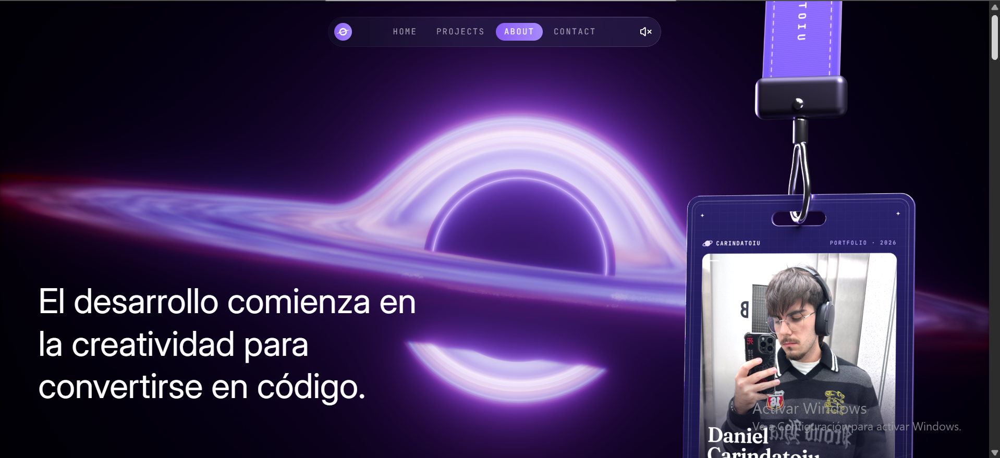

# 🌐 CV portfolio — Vue

> Portfolio personal con **Vue 3**, **TypeScript**, **Vue Router** y **Lucide**. Mismo contenido y diseño que la versión original en React.

---

## 📖 Descripción

Implementación en Vue de mi portfolio, que primero hice en React. Elegí Vue porque me resulta más cómodo: plantillas cercanas al HTML (`v-if`, `v-for`, `@click`), componentes `.vue` que separan plantilla, lógica y estilos, reactividad integrada sin `useEffect` y un enrutador oficial.

He mantenido **el mismo contenido y diseño** a propósito: así las diferencias entre las dos versiones son solo las del framework.

---

## 🖼️ Capturas

| Portatil |
|:---:|
| |

---

## 🛠️ Tecnologías

| Tecnología | Uso |
|---|---|
| **Vue 3** | Framework (Composition API con `<script setup>`) |
| **TypeScript** | Tipado de props y datos |
| **Vue Router** | Navegación sin recargar (SPA) |
| **Lucide** (`lucide-vue-next`) | Iconos SVG |
| **Vite** | Servidor de desarrollo y build |

---

## 🔄 React vs Vue

| Concepto | React | Vue |
|---|---|---|
| Estado | `useState` | `ref()` |
| Props | `function Card({ title })` | `defineProps<{ title: string }>()` |
| Eventos | `onClick={fn}` | `@click="fn"` |
| Condicional | `{cond ? <A/> : <B/>}` | `v-if` / `v-else` |
| Listas | `items.map(...)` | `v-for` |
| Contenido del padre | `children` | `<slot>` / `v-slot` |
| Enlaces | `<Link>` | `<RouterLink>` |
| Iconos | `lucide-react` | `lucide-vue-next` |

La lógica, el HTML y el CSS son prácticamente iguales; cambia la forma de declararlos.

---

## 🔗 Alias `@`

El proyecto **no traía el alias `@` configurado**, así que imports como `@/components/...` fallaban. Lo creé en dos sitios: Vite lo necesita para compilar y TypeScript para el editor.

```ts
// vite.config.ts
resolve: {
  alias: { '@': fileURLToPath(new URL('./src', import.meta.url)) },
},
```

```json
// tsconfig.app.json → compilerOptions
"paths": { "@/*": ["./src/*"] }
```

> ⚠️ `alias` tiene que ir **dentro de `resolve`**. Fuera da el error `'alias' does not exist in type 'UserConfigExport'`. Después hay que reiniciar `npm run dev`.

Ahora `@` apunta a `src/`:

```ts
import EntryList from '@/components/entries/EntryList.vue'
```

---

## 🧱 Organización

- **Datos separados** en `src/data/` (experiencia, estudios, proyectos), tipados con `interface`.
- **`EntryList`**: lista genérica con *slot* que usan Experiencia y Estudios. La lista pone las líneas y las columnas, y cada sección decide qué pinta en cada fila.
- **Clases BEM** (`bloque__elemento--variante`) y tamaños en `rem` con variables CSS.

```
src/
├── components/entries/   # EntryList, ExperienceEntry, EducationEntry
├── data/                 # experiences.ts, education.ts, projects.ts
├── views/                # HomeView, ProjectView, NotFoundView
├── router/index.ts
├── App.vue
└── main.ts
```

---

## 🚀 Instalación

Requiere **Node.js 20.19 o superior**.

```bash
npm install
npm run dev      # http://localhost:5173
npm run build    # versión de producción en dist/
```

---

## 👤 Autor

**Daniel Carindatoiu** · [GitHub](https://github.com/dcarindatoiu) · hola@carindatoiu.dev

---

## 📄 Licencia

**© 2026 Daniel Carindatoiu. Todos los derechos reservados.**

El código es público solo para consulta y aprendizaje. Queda prohibido, sin permiso escrito del autor, copiar, modificar, redistribuir o presentar como propio el código, el diseño, los textos o las imágenes.
